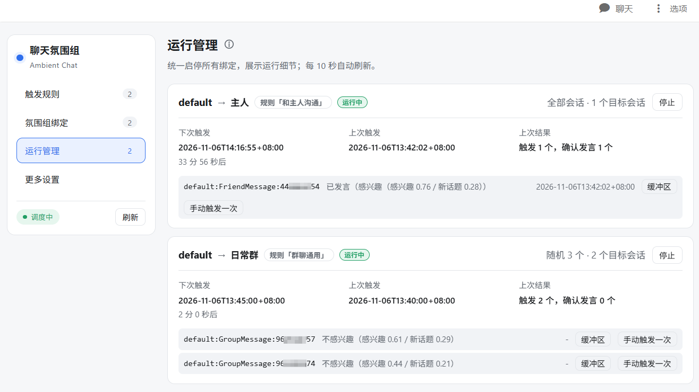

<p align="center">
  
</p>

<h1 align="center">聊天氛围组</h1>

<p align="center">让 AI 在群聊与私聊中像真人一样「在场」：按时机、按兴趣决定要不要接话，偶尔主动开个新话题，而不是只能等被点名。</p>

<p align="center">
  
  
  <a href="LICENSE"></a>
  <a href="https://github.com/AlionSSS/astrbot_plugin_ambient_chat/releases"></a>
</p>

## 这是什么

AstrBot 的机器人默认只会一问一答，主动回复也仅按概率触发。聊天氛围组补上的是「自己判断该不该说话」这一层：

- **有规则**：一条 Ambient 规则描述「什么时候考虑看聊天会话、什么情况下跳过聊天会话、思考要不要发言、用哪个模型说」。
- **有边界**：规则只是配置，没有任何启停状态；它通过 Ambient 绑定落到具体的机器人应用与私聊/群聊上，启停只存在于绑定。
- **有判断**：拦截条件先做一票否决，再交给决策模型判断「感不感兴趣」「想不想开新话题」，都不过就放弃本次发言。

## 和默认行为有什么不同

| | 默认自动回复 | 概率主动回复 | 聊天氛围组 |
| --- | --- | --- | --- |
| 触发来源 | 用户发消息 | 随机概率 | cron / 一次性时刻 / 时段随机 / 固定间隔 |
| 说话判断 | 无 | 随机 | 拦截（静默时段、冷却、未读不足、连发无人回应）+ 决策思考 |
| 策略复用 | — | — | 规则与绑定分离，一份策略可挂多个号、多个会话 |

## 功能特点

- **四种触发入口**：crontab、一次性时刻、每天窗口内随机 N 次（可限定周几与最小间隔）、从启动起算的固定间隔（可带抖动）。
- **四类拦截**：静默时段（支持跨午夜）、自身活跃度冷却、群未读不足、连发无人回应（填极大值即永久等待），任一命中即放弃该会话本次发言。
- **决策模型**：用 SystemOne 协议输出「感兴趣 / 想开新话题」的判定值，可接 AstrBot 官方判断提供商，也可在「更多设置」里配置自定义端点供规则用 `custom:<id>` 引用；判定失败一律放弃。
- **一对多扇出**：一条绑定可带多个私聊/群聊，挑选策略支持「全部」「等概率随机挑 N 个」「按关注度加权挑 N 个」，并受全局并发与最小发言间隔约束。
- **关注度**：决策模型历次判定会按会话累积关注度，加权挑选时更常光顾聊得起来的会话；可在「运行管理」逐会话查看，或按绑定「重置关注度」。细节见 [使用手册](docs/usage.md)。
- **上下文缓冲**：按会话维护最近消息，启动时从核心历史预热；支持按发送者 ID 过滤，可只读快照查看注入模型的文本。
- **人格一致**：沿用会话当前生效人格（`/persona` 切换也生效），与正常对话保持一致。
- **多模态**：默认缓存图片作为视觉输入（可在「更多设置」关闭），可选缓存语音作为音频输入（默认关闭），各按 AstrBot 供应商的 `modalities` 决定是否附带；带媒体失败时仅本次去掉媒体重试，不记作永久能力限制。
- **WebUI 控制台**：触发规则、氛围组绑定、运行管理、更多设置四个页面，支持对单个会话「手动触发一次」验证效果。

## 工作原理

```
触发入口 → 挑选目标会话 → 拦截 → 发言意向 → 生成与投递
```

| 阶段 | 可选内容 | 说明 |
| --- | --- | --- |
| 触发入口 | cron / 一次性时刻 / 时段随机 / 固定间隔 | 可配置多条，任一命中即进入下一阶段 |
| 挑选目标会话 | 全部 / 等概率随机挑 N 个 / 按关注度加权挑 N 个 | 一对多时控制单次扇出规模；加权模式按关注度从高到低逐个处理 |
| 拦截 | 静默时段 / 自身活跃度冷却 / 群未读不足 / 连发无人回应 | 按会话独立判断，任一命中即放弃该会话本次发言 |
| 发言意向 | 按概率放行 / 决策模型判定 | 按概率放行时由设定概率决定是否发言（100% 即必定发言）；决策模型判断「感不感兴趣」「想不想开新话题」 |
| 生成与投递 | 对话模型 | 按「缓冲最近 N 条消息 + 会话当前人格」组装提示，单独请求一次对话模型后发送；不经过核心管线 |
| 人格 | 会话当前生效人格 | 规则「基础设置」里的「向模型注入人格」同时控制决策模型与对话模型 |

## 安装

1. AstrBot 版本需满足 `>=4.29.4,<5`，并已启用 `aiocqhttp` 适配器。
2. 在 WebUI「模型提供商」中准备一个可用的对话模型。
3. 安装插件，两种方式任选：
   - 插件市场搜索「聊天氛围组」安装；
   - 手动把本仓库放到 AstrBot 的 `data/plugins/astrbot_plugin_ambient_chat`，然后重载插件。
4. （可选）要用决策模型时，先在 AstrBot 里配好判断提供商，或在「更多设置 → 决策模型」里添加自定义 SystemOne 端点。

## 建议的 AstrBot 配置

本插件接管的是「自己判断该不该开口」，所以有两处核心配置值得顺手改一下（位于 WebUI「配置 → 扩展功能 → 群聊上下文感知」）。首次打开本插件控制台时也会提示一次：

- **开启「持久化群聊消息记录」**：插件启动时从核心的平台消息历史预热群聊缓冲。不开持久化，缓冲区只能从之后零星收到的消息慢慢攒，刚开始运行的一段时间里上下文是空的，拦截与决策都容易判错。同时把「持久化最大消息数量」调到不小于本插件「更多设置 → 上下文缓冲」的条数（默认 100），留点余量更好——核心存得比插件缓冲还少时，预热同样读不满。
- **关闭「主动回复」**：按概率触发的主动回复与本插件是同一件事的两种做法，同时开着会各说各话，出现重复发言、彼此抢话。关掉它，主动开口完全交给规则（什么时候考虑看聊天会话）、拦截（什么情况下跳过聊天会话）和决策模型（思考要不要发言）。

## 快速上手

1. **建规则**：插件详情页 →「聊天氛围组」→「触发规则」→「新建规则」，选好触发入口、拦截与发言意向，保存。
2. **建绑定**：「氛围组绑定」→ 左栏选一个机器人应用 →「新增绑定」，粘贴目标会话的 UMO（每行一个），选挑选策略后保存（选「按关注度加权」时，规则建议用「决策模型判定」，否则关注度不会更新）。
3. **启动**：「运行管理」页启动该绑定。启动会先读取历史预热上下文，期间可以取消。
4. **观察**：在「运行管理」页看下次触发时间、上次结果、每个会话的关注度与观测次数；想立刻验证，可对某个会话点「手动触发一次」（会真的发送，仍走拦截与意向判断，可能最终不发言）。
5. **调优**：没发出去就放宽拦截或调低阈值；发太频繁就收紧触发窗口、加冷却或降低并发；觉得某条绑定总是偏向少数会话，可在「运行管理」点「重置关注度」。

> 新建或保存绑定只改配置，不会自动启动；运行中的绑定只读，要改配置先停止。



## 配置

插件配置页只有一个总开关 `enabled`（默认开启，关闭后仅暂停调度，规则与页面保留）。运行参数在「更多设置」里：

| 分组 | 代表项 | 默认值 |
| --- | --- | --- |
| 发言节奏 | 同时进行的发言数上限 / 两次发言最小间隔 | `1` / `2.0` 秒 |
| 上下文缓冲 | 每个会话保留的近期消息条数 / 是否缓存图片 / 是否缓存语音 | `100` / 开启 / 关闭 |
| 调试 | 记录决策调试日志（含人格与聊天内容） | 关闭；最多 100 条、总计 10 MiB |
| 决策模型 | 自定义 SystemOne 端点列表 | 空 |

完整参数表、取值范围、`settings.json` 结构与运行期行为见 **[docs/usage.md](docs/usage.md)**。

## 常见问题

- **一直不发言？** 依次检查绑定是否已启动、拦截条件是否命中（静默时段/冷却/未读不足/连发无人回应）、阈值是否过高，以及该会话是否有当前 LLM 会话（没有会直接跳过）。
- **显示「投递失败」？** 通常是绑定的机器人应用没连上，或选错了平台实例。看「氛围组绑定」左栏是否标「未连接」。
- **绑定改不了/删不掉？** 运行中的绑定只读，先在「运行管理」页停止。
- **停止期间的消息会丢吗？** 缓冲会清空，重新启动时从核心历史预热补回（群聊依赖核心的群消息持久化，私聊只含走过 LLM 的消息）。
- **能用别的平台吗？** 当前只声明支持 `aiocqhttp`，其他平台未验证。
- **加权挑选总是挑中同几个会话？** 先确认规则的发言意向是「决策模型判定」（按概率放行不会更新关注度），再在「运行管理」点「重置关注度」。

更多边界见 **[docs/limitations.md](docs/limitations.md)**。

## 开发

```bash
ruff check .
ruff format --check .
python -m pytest tests -q
python -m compileall .
```

源码按职责分层：

```text
├─ main.py                    插件注册、依赖组装与消息入口
├─ webapi.py                  WebUI 接口
├─ common.py                  共享常量与轻量工具
├─ rules/                     规则、绑定、更多设置的数据模型与统一提交
├─ conversation/              消息表示、历史读取、上下文缓冲、图片转存
├─ speech/                    拦截、发言意向、决策模型、生成投递
├─ runtime/                   绑定生命周期、调度与执行管理
├─ views/console/             嵌入 AstrBot WebUI 的控制台
└─ tests/                     关键行为回归测试
```

约定与背景：

- `CONTEXT.md` —— 领域词汇表，设计讨论与命名以它为准。
- `docs/adr/` —— 架构决策记录（30 篇）。
- `docs/usage.md` / `docs/limitations.md` —— 面向使用者的配置手册与已知限制。
- `speech/systemone_sdk.py` 是独立的单文件 SystemOne SDK，不依赖 AstrBot，可单独复制使用。

## License

[AGPL-3.0](LICENSE)
